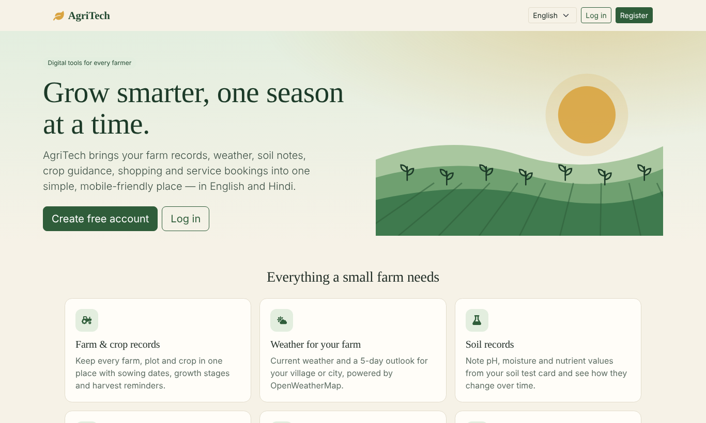
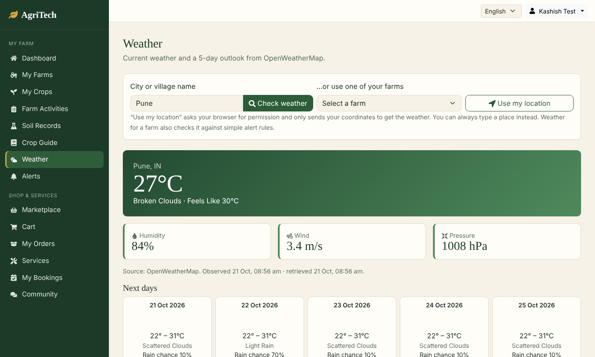
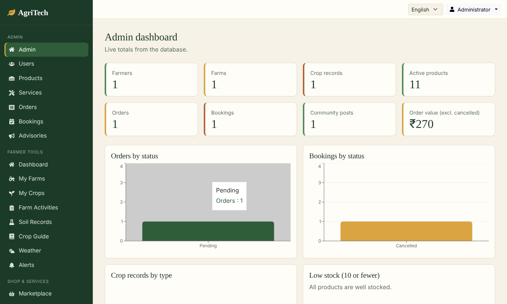

# AgriTech — Empowering Farmers Through Digital Technology

SkillWallet Full Stack Development (MERN) · Individual capstone · Category: Agriculture

AgriTech is a MERN web app (MongoDB, Express, React, Node.js) that helps farmers manage farms and crops, check weather, keep soil records, read a crop guide, buy farm resources (demo checkout), book services and talk to other farmers. Administrators manage users, products, services, orders, bookings and advisories.

> **Honesty notes** – Soil values are numbers the farmer types in (no sensors). Alerts come from simple published rules, not AI. Checkout is a **demo** (no payment, no card data). Weather needs your own free OpenWeatherMap key. Seeded products/services are labelled **Demo**.

## Tech stack
| Layer | Tools |
|---|---|
| Frontend | React 19, Vite, React Router, Axios, React-Bootstrap/Bootstrap 5, React Icons, Recharts |
| Backend | Node.js (v20+), Express 5, Mongoose 9, JWT, bcryptjs, zod (validation), helmet, express-rate-limit, cors |
| Database | MongoDB Atlas (database `AgriTech`) |
| Testing | Jest + Supertest (39 API tests), Playwright browser script (20 journeys) |

## Features
Farmer: register/login, profile, farms (CRUD), crops (CRUD, filters, lifecycle page), farm activity log, soil records + chart + guidance, crop guide + pest/disease notes, weather (city / coordinates / farm, 5-day outlook), rule-based alerts, marketplace + cart + demo orders + history + cancel, services + bookings (create, reschedule, cancel), community forum (posts, comments), English/Hindi interface, dashboard from real data.
Admin: stats dashboard (real aggregates), users (role/disable), products & inventory, services, orders (status flow), bookings (status flow), advisories (broadcast alerts), forum moderation.

## Folder structure
```
AgriTech/
├── client/                 React app (Vite)
│   └── src/{components,context,hooks,i18n,layouts,pages,services,utils}
├── server/                 Express API (MVC)
│   ├── config/db.js        MongoDB connection (connect first, then listen)
│   ├── models/             Mongoose schemas (Model)
│   ├── controllers/        business logic (Controller)
│   ├── routes/index.js     REST endpoints (Routes / "View" layer of the API)
│   ├── middleware/         auth, validation, errors
│   ├── services/           weatherService, alertService
│   ├── validators/         zod schemas
│   ├── data/cropInfo.json  crop reference library
│   ├── seeds/              seedAdmin.js, seedDemo.js
│   ├── tests/              Jest + Supertest
│   └── index.js            entry point
└── docs/                   architecture, ER, API, report, demo script, viva, test results …
```

## Setup (Windows + VS Code)
Prerequisites: Node.js 20+ (`node -v`), npm, Git, a MongoDB Atlas cluster.

**1. MongoDB Atlas** – Database Access: create a *database user* (this is not your Atlas login). Network Access: add your current IP (or `0.0.0.0/0` for development only). Connect → Drivers → copy the `mongodb+srv://…` string. Put `/AgriTech` before the `?`. If the password has special characters (`@ : / ? # %`) URL-encode them.

**2. Backend** (terminal 1)
```powershell
cd D:\Kashish-Project\AgriTech\server
npm install
copy .env.example .env      # then edit .env (MONGO_URI, JWT_SECRET, OPENWEATHER_API_KEY, ADMIN_*)
npm run dev
```
You must see `MongoDB connected successfully` **before** `Server running on port 8000`. If the connection fails the server prints the reason and exits.

**3. Frontend** (terminal 2)
```powershell
cd D:\Kashish-Project\AgriTech\client
npm install
copy .env.example .env.local
npm run dev
```
Open http://localhost:5173.

**4. Admin account + demo data** (once, backend folder)
```powershell
cd D:\Kashish-Project\AgriTech\server
npm run seed:admin    # uses ADMIN_EMAIL / ADMIN_PASSWORD from .env
npm run seed:demo     # optional: demo products & services (labelled "Demo")
```
Admin access can never be obtained from the registration form.

**5. Weather key** – create a free account at https://home.openweathermap.org/users/sign_up, copy the key from *API keys*, set `OPENWEATHER_API_KEY` in `server/.env`, restart the server. New keys can take a short while to activate. Without a key the weather page shows a clear "not configured" message (or labelled demo data if `OPENWEATHER_DEMO=true`).

## Tests
```powershell
cd server
# Tests DELETE all data in the database they use. Point them at a separate database whose name ends in _test:
$env:MONGO_URI_TEST="mongodb+srv://<user>:<pass>@cluster0.eybnl67.mongodb.net/AgriTech_test?retryWrites=true&w=majority"
npm test
cd ..\client
npm run lint
npm run build
```
See `docs/TEST-PLAN.md` for what was run and the actual results.

## Troubleshooting
| Symptom | Fix |
|---|---|
| "Server running" but no "MongoDB connected" (old code) | The old `index.js` started listening without awaiting `mongoose.connect`. Use the provided `index.js` + `config/db.js`. |
| `MongoServerError: bad auth` | Wrong database-user password (not Atlas login), or un-encoded special characters. |
| `ECONNREFUSED` / `querySrv ENOTFOUND` / timeout | Atlas Network Access does not include your IP, or your network blocks SRV DNS (try another network / use the non-SRV string from Atlas). |
| CORS error in the browser | `CLIENT_URL` in `server/.env` must equal the frontend origin (`http://localhost:5173`). |
| Frontend shows "Cannot reach the server" | Backend not running, or `VITE_API_URL` wrong. |
| Weather 503 / 502 | Key missing / rejected; wait for key activation. |
| Login works but admin pages redirect | The account is a farmer; run `npm run seed:admin` with that email to promote it. |

## More documentation
`docs/ARCHITECTURE.md` · `docs/ER-DIAGRAM.md` · `docs/API.md` + `docs/AgriTech.postman_collection.json` · `docs/TEST-PLAN.md` · `docs/DEMO-SCRIPT.md` · `docs/VIVA.md` · `docs/KNOWN-LIMITATIONS.md` · `docs/PROJECT-REPORT.md` · `docs/KANBAN-PROGRESS.md` · `docs/EVALUATION-MATRIX.md` · `docs/SUBMISSION-CHECKLIST.md` · `docs/MERGE-GUIDE.md`

## Screenshots
Taken in a sandbox with a local stand-in for the weather provider — **retake them on your machine with your real key for the report** (see `docs/DEMO-SCRIPT.md`). Files are in `docs/screenshots/`.

  
