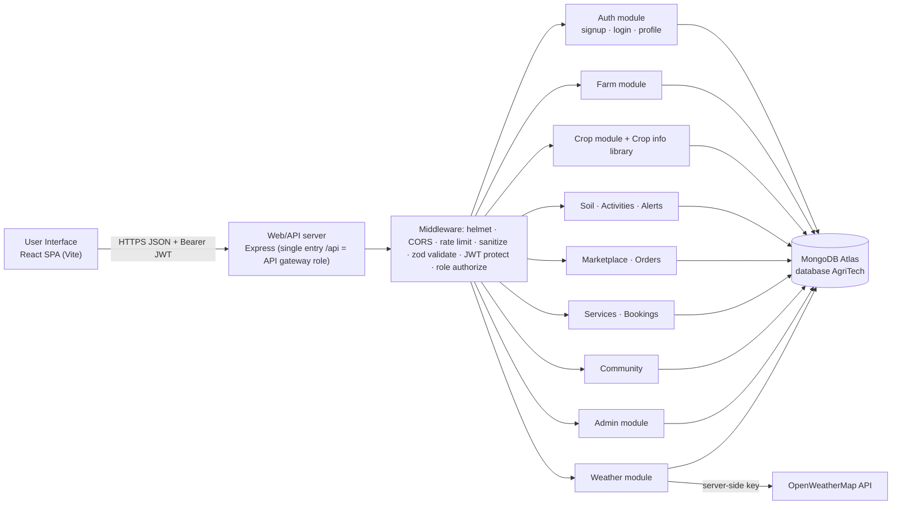

# Architecture

AgriTech is a **modular monolith**: one React SPA, one Express API, one MongoDB database. The SkillWallet diagram's "services" (Authentication, Signup, Login, Weather, Farm, Crop, Crop Info, Buy Resources, My Bookings) are modules inside the API — each with its own route entries, controller and model — not separately deployed microservices.

## Technical architecture

The Express `/api` router plays the **API-gateway** role (single entry point, shared security middleware). The Vite dev server / static host plays the **web server** role for the UI.

## MVC in the backend
| Layer | Folder | Responsibility |
|---|---|---|
| Model | `server/models` | Mongoose schemas, validation, indexes, relationships |
| Controller | `server/controllers` (+ `services/`, `utils/ownedCrud.js`) | Business rules (ownership, stock, booking capacity), calls models, shapes responses |
| Routes ("view" of a REST API) | `server/routes/index.js` | Maps HTTP verb + URL → middleware chain → controller |

Request path: `route → [rate limit] → protect (JWT) → authorize (role) → validate (zod) → controller → model → response`.
Errors are thrown as `ApiError` and formatted once in `middleware/error.js`.

Adaptation note: the SkillWallet walkthrough puts the DB connection and models under `db/`. This project uses `config/db.js` and `models/` (same MVC idea, conventional names).

## Frontend structure
`pages/` (one component per screen, lazy-loaded) · `components/` (ui, FormModal, RequireAuth) · `layouts/` (public shell, app shell with sidebar/offcanvas) · `context/` (Auth, Cart, Language, Toast) · `services/api.js` (Axios + token interceptor) · `hooks/useFetch.js` · `i18n/` (en, hi).
State strategy: React Context for session/cart/language; server data is fetched per page with `useFetch`.

## Roles & access control
| Role | Can |
|---|---|
| Farmer (default) | own profile, farms, crops, activities, soil, orders, bookings, forum posts; read products/services/crop info; weather |
| Admin (seeded or promoted by another admin) | everything admin-only: users, product/service CRUD, all orders/bookings and status changes, advisories, stats, forum moderation |
Enforced in the API (`protect` + `authorize('admin')` + per-record `owner` filters). The React route guard is only convenience. The user's role is re-read from the database on every request, so demoting/disabling takes effect immediately. No separate "expert" role is implemented; consultations are a service category handled by admins.

## Authentication & token strategy
bcrypt (cost 10) hashes passwords; JWT (HS256, 1 day, payload = user id only) is returned at login/registration, kept in `localStorage`, sent as `Authorization: Bearer`. Logout deletes the token client-side (tokens are stateless, so they cannot be revoked server-side before expiry — see limitations).

## Key design decisions
* **Owner scoping**: every farmer-owned query includes `{ owner: req.user.id }` (generic `utils/ownedCrud.js`), so other farmers' records return 404, and referenced farms/crops are checked for ownership on write.
* **Orders**: server loads prices, ignores client totals, reserves stock with an atomic conditional update (`stock >= qty` + `$inc`), rolls back earlier lines if a later line fails, and restores stock on cancel. An in-process lock adds a second guard on a single server. No multi-document transactions are used, so it also works on a standalone MongoDB.
* **Bookings**: simplified availability — each (service, date, slot) allows `capacityPerSlot` active (pending/confirmed) bookings; past dates and unknown slots are rejected; only pending bookings can be rescheduled.
* **Weather**: server-side proxy, key never sent to the browser, 15-minute cache in `WeatherCache`, clear errors for invalid city / bad key / provider limit / network failure; browser geolocation is requested only when the user presses the button.
* **Alerts**: transparent rules (listed in `services/alertService.js` and shown on the Alerts page), de-duplicated per user/rule/day.
* **Crop library**: static, attributed JSON (`server/data/cropInfo.json`) with disclaimer; maintainable by editing the file.

## User flow
Home → Register/Login → Dashboard → Farms → Crops → Crop info → Weather → Marketplace/Cart → Orders → Services → Bookings (matches the SkillWallet flow), plus Soil, Alerts, Community, Profile. Admins land on the Admin dashboard.
